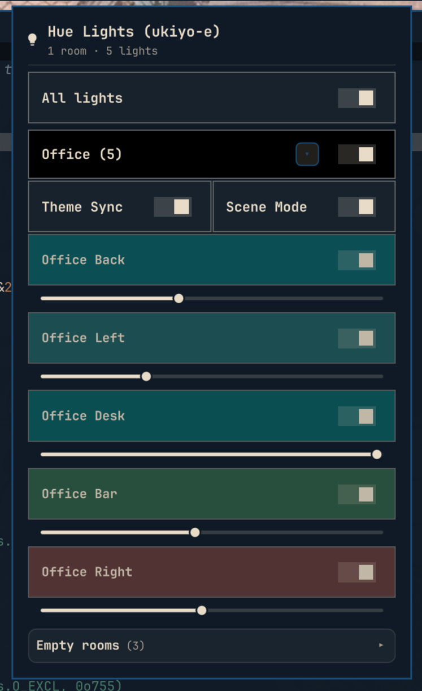

# omarchy-philips-hue

Omarchy / Quickshell bar widget for controlling Philips Hue lights over the bridge's local HTTPS APIs (v1 and v2).

<p align="center">
  
</p>

## Features

- Bar icon (lightbulb) that opens a control panel
- Toggle all rooms, individual rooms, or single lights
- Party Mode: theme colors flow between a room's bulbs every 1.5 seconds
- Music Sync: bulbs pulse on the detected beat of whatever is playing, streamed
  over the Hue Entertainment API (requires a bridge that supports it — see below)
- Compact per-room scene browser for saved bridge scenes and four built-in presets; six tiles per page, with search for longer lists
- Every room and light row is tinted with the bulb's current color
  (hue/sat, color temperature, or XY as reported by the bridge)
- Per-room brightness slider for dimming or brightening every light in a room together
- Per-light brightness slider
- Per-light color temperature slider (warm ⇄ cool white)
- Per-light color wheel picker (hue + saturation) and color temperature slider;
  both hidden for lights in rooms with theme sync enabled
- Favorite rooms stay pinned at the top of the panel; use the star beside a room
  (favorites are stored in `hue-theme.json`)
- Preview the active theme on an opted-in room immediately from its expanded controls
- Authentication, TLS, timeout, and invalid-response failures have distinct labels
  and short recovery hints; unreachable lights are shown separately, with the last
  successful refresh time and a manual retry; polling backs off while the bridge
  is unreachable and pauses while the panel is closed
- State refreshes are serialized and validate command output before updating the
  panel, preventing overlapping requests or partial results from appearing as a
  successful refresh
- Refreshes use one helper process and one resource read on v2; v1 reads lights,
  groups, and scenes once each. Failed refreshes preserve the last complete state.
- Commands run in order, report failures in the panel, and refresh state after
  the queue drains. Color pickers stay open across refreshes.
- The master toggle includes lights outside rooms. Light counts are unique even
  when a bulb belongs to both a room and a zone.
- Keyboard-accessible room, favorite, and scene controls
- Supports both the classic Hue API v1 and CLIP API v2
- Reads credentials from `~/.local/state/omarchy/settings/hue.json`
- Retries / re-fetches state automatically after every change

## Requirements

- Arch Linux + Omarchy (Quickshell-based shell)
- `python3` (for the pairing script), `omarchy-shell`

## Install

```sh
omarchy plugin add https://github.com/sethchev/omarchy-philips-hue.git --enable
```

## Pairing with the bridge

On first run the bar shows a lightbulb icon. Click it to open the panel, then
click **Pair with bridge**. This opens a terminal — press the link button on
your Hue bridge when prompted. The script discovers the bridge, requests an
application key, checks whether v2 is available, and writes
`~/.local/state/omarchy/settings/hue.json`. New pairings use v2 when the
bridge supports it and otherwise use v1. The panel picks up the new
credentials automatically within seconds.

You can also pair manually:

```sh
~/.config/omarchy/plugins/omarchy-philips-hue/pair.sh
```

Pass an IP directly to skip auto-discovery: `pair.sh 192.168.1.14`.
Set `PHILIPS_HUE_API_VERSION=v1` or `v2` to force a version during pairing;
the default is automatic detection.

### Moving an existing pairing to v2

The v1 username is also the v2 application key, so **you do not need to
re-pair or press the bridge button**. Verify the existing key and switch the
plugin atomically with:

```sh
python3 ~/.config/omarchy/plugins/omarchy-philips-hue/hue-api.py migrate-api v2
```

Existing credential files without an `apiVersion` remain on v1 until this is
run. To switch back, use the same command with `v1`. Re-pairing is only needed
if the key was revoked or the bridge was reset or replaced.

## Party Mode

Party Mode animates the active theme's palette across a room's bulbs. It runs
entirely through the plugin's normal light commands, so **it works on every
bridge this plugin can pair with** — both the classic v1 API and CLIP v2,
including first-generation (round) Hue Bridges. No special hardware or
Entertainment features are required.

### What you need

- Any Hue Bridge the plugin pairs with (v1 or v2, any generation)
- At least one switched-on, reachable **color-capable** bulb in the room;
  white-only bulbs are skipped

### How it works

Expand a room and turn on **Party Mode**. A single color-capable light advances
through each palette color every 1.5 seconds. With multiple lights, colors move
to the next bulb every 1.5 seconds with a half-second fade. All palette colors
take part, even when there are more colors than bulbs. Brightness stays
unchanged; off, unreachable, and white-only lights are skipped without shifting
the other bulbs' positions.

Use **Arrange party light order** to put the lights in their physical order
around the room. The up/down buttons save the order under `partyOrder` in
`hue-theme.json`; newly discovered lights follow the saved ones.

Party Mode works with Theme Sync on or off and does not require thpm. While it
runs, theme sync leaves those bulbs alone and manual color controls are hidden.
Changing themes updates the moving palette. Choosing a saved scene or built-in
preset stops Party Mode in overlapping rooms before applying the scene.
Overlapping rooms/zones cannot start competing parties.

Turning Party Mode off restores the normal theme for synced rooms, or the
previous bulb colors for rooms with sync off. Closing the panel keeps the
party running. Shell/plugin reloads stop the worker and leave its last colors
in place; Party Mode always starts off after a restart. Light order is retained.

One local Python worker runs with the plugin. While Party Mode is active it
reads bridge state once per frame and sends color writes individually, using
the shared v1/v2 HTTPS client. Writes are serialized; missed frames are dropped,
and bridge errors pause animation with bounded retries and a panel message.
An idle worker sends no bridge requests. No Hue scenes are created for animation.

## Music Sync

**Music Sync** makes the room's bulbs pulse on the detected beat of whatever is
playing, streaming colors and brightness directly to the bridge over the
**Hue Entertainment API** instead of sending individual light commands.

### What you need (hub support)

Music Sync depends on bridge hardware. Unlike Party Mode, it requires a Hue
Bridge that supports the Entertainment API:

- A **second-generation (square) Hue Bridge or newer** (for example the Hue
  Bridge Pro), with up-to-date firmware. First-generation **round** bridges do
  not support Entertainment Areas or CLIP v2 and cannot accept entertainment
  streaming — on those, the Music Sync toggle does not appear and only Party
  Mode is available.
- An **Entertainment Area** created in the Hue app that contains exactly the
  color lights of the room you want to sync (Hue app → Settings → Entertainment
  areas). The plugin uses existing areas and never changes their configuration.
- **Entertainment pairing** — a separate application key and streaming key
  requested once from the bridge (see [Preparing Hue Entertainment](#preparing-hue-entertainment)).
  The panel shows a **Pair music sync** button for rooms that are not yet paired.
- On the computer: `aubio` (`omarchy pkg add aubio`), `pw-cat` and `pactl`
  (PipeWire), and system OpenSSL with DTLS 1.2 PSK support. No Python audio or
  crypto packages are needed.

Only one music stream can run on the bridge at a time, and an area already in
use by another app is left alone. The toggle only appears for rooms whose
Entertainment Area requirements are met and whose pairing succeeded.

### How it works

**Music Sync** uses the system **aubio** real-time tempo tracker to hold a
rhythmic beat clock, rather than reacting to every bass-volume spike. Fixed
theme colors sit at **10% between beats** and smoothly rise to **75% on the
predicted beat**, then fade down. These are absolute brightness targets,
independent of the bulbs' brightness when Music Sync starts. Switched-off bulbs
stay off. Original brightness is saved and restored when leaving Music Sync.

The panel shows **Rhythm locked**, estimated BPM, confidence, and tracked beat
count. Acquisition takes several seconds. If confidence, rhythmic evidence, or
audio continuity is lost, the lights settle to the between-beat level.

**Between beats** and **On beat** adjust the low and high brightness targets.
**Pulse pace** adjusts the width of the rise/fall within each beat period. The
beat clock begins the rise ahead of the beat; a short rounded peak keeps the
75% target reachable at the 25 Hz streaming cadence. Color smoothing is applied
separately, so it cannot flatten or delay the brightness envelope. Entry into
the mode fades from the previous lighting over 400 ms.

**Sensitivity** fine-tunes aubio's onset threshold without bypassing rhythm
lock. **Timing offset** (−300 to +300 ms) calibrates physical playback/network/
bulb latency: negative values move the peak earlier and positive values later.
Software peak scheduling is tested against known clicks; physical bulb latency
is not measured automatically. The old relative pulse-depth setting is retained
in existing settings files for compatibility but is no longer used.

All samples are processed in sequence. A large capture backlog or a default
output change explicitly resets the tracker instead of feeding it silently
truncated audio. Theme changes and slider adjustments remain smoothed. Sliders
apply while dragging, with writes batched every 150 ms. Saved light order
determines the fixed palette assignment.

To diagnose tracking without connecting to the lights or saving audio:

```sh
python3 -B hue-beat-check.py metronome --bpm 120 --seconds 30
python3 -B hue-beat-check.py playback --seconds 30
```

The metronome is synthesized in memory, never played through the speakers.
The tests check reference-click timing at 90/120/150 BPM, guitar interference,
rejection of stationary noise and tones, confidence loss, capture continuity,
and alignment through the actual pulse-rendering pipeline. Those software
measurements are not measurements of physical bulb timing.

### Privacy and audio handling

Playback is captured from the default PipeWire output monitor, including all
sound on that output. The microphone is never selected. Samples stay in memory
and are never recorded to files or uploaded. Capture follows default-output
changes and exists only while Music Sync is on. Frames stream locally to the
bridge at up to 25 Hz, without per-frame REST writes.

Music Sync and Party Mode are mutually exclusive: selecting one stops the
other. Turning either mode off restores the room's normal theme or saved
colors. Scenes and manual light/room power or brightness changes stop music
streaming before applying the requested control. Shell/plugin shutdown releases
both the audio capture and Entertainment Area. Music Sync starts off after a
restart.

A room's Entertainment Area must contain exactly that room's color lights;
areas mixing rooms or containing lights from other rooms are never claimed.
Playback errors stop Music Sync, release its resources, and appear in the
room's status message.

### Preparing Hue Entertainment

Music synchronization needs a separate Entertainment application key and DTLS
streaming client key. Existing regular-control pairings can add them with:

```sh
python3 -B ~/.config/omarchy/plugins/omarchy-philips-hue/hue_entertainment.py pair
```

Press the physical bridge link button when prompted. The helper first checks
Entertainment API support — on a first-generation round bridge, or a bridge
without Entertainment support, pairing stops here with an error and existing
credentials are left unchanged. On a supported bridge it requests both keys,
verifies the new application key, and saves them under `entertainment` in the
existing private `hue.json`. The regular control key is preserved. Keys are
never printed or logged. A failed or expired pairing leaves existing
credentials unchanged. This pairing step does not start a stream or change the
Entertainment Area configuration.

## Scenes

Open a room in the panel and expand **Scenes** to browse its saved bridge scenes
alongside any missing built-in presets. Active saved scenes appear first. The
browser stays collapsed until opened and shows at most six tiles in two columns;
use the arrows for more scenes, or search by name when there are more than six.
Long names are shortened on tiles; hover or keyboard-focus a tile for its full
name. Saved scenes are recalled by ID, so same-named scenes remain distinct and
scenes from other rooms never appear in this room's list.

The four built-in presets remain available:

- **Relax** — warm, comfortable, lower-brightness white
- **Read** — brighter warm white for reading
- **Natural Light** — bright neutral/cool daylight
- **Tv Mode** — dim accent lighting for color-capable bulbs, with warm fallback for white-only bulbs

When you choose a scene, the plugin first looks for a same-named Hue scene for
that room/zone and recalls it only there. If the bridge does not already have that preset
for a room, the plugin creates a room-scoped scene from the built-in recipe and
then recalls it. This keeps existing Hue app scenes intact while filling in
missing presets such as Natural Light.

Connection failures use the existing panel status and a short hint, with no
separate diagnostics view:

| Status | Suggested next step |
| --- | --- |
| Authentication failed | Re-pair the bridge to renew access |
| TLS connection failed | Check bridge identity and the system clock |
| Bridge timed out | Check the bridge and network, then retry |
| Invalid bridge response | Retry; check firmware if the problem persists |
| Bridge unreachable | Check power, network, and the configured IP |

The last complete snapshot stays visible during failures. **Retry now** and
polling backoff continue to work; a successful refresh clears the connection
error. Action failures use the same categories. The panel requests structured
errors with `--json-errors`; direct CLI commands keep their readable text errors.
Diagnostic labels never display raw bridge response bodies or transport URLs.

## Syncing lights with the omarchy theme

> **Requires thpm (Theme Hook Plugin Manager, `io.github.oldjobobo.thpm`).**
> Theme sync drives off the `theme-set` hook chain, which thpm manages and which
> sources its environment from `~/.local/share/thpm/lib/theme-env.sh`. Without
> thpm installed, the `45-hue.sh` hook does not run and lights stay on their
> last color. Install the thpm plugin before enabling theme sync.

A theme-set hook (`45-hue.sh`, vendored in `theme-sync/`) recolors every
room/zone from the active theme whenever you run `omarchy theme set`: either
the accent color, or — when scenes are enabled — a per-light scene built from
the theme's palette. The bar widget picks the change up within its 15 s poll.

### Per-room opt-out

Each room that is switched on gets a **Theme Sync** toggle in the panel,
right below its own toggle. Every room starts out synced; toggling a room
off excludes it from theme changes until you re-enable it.

Turning a room's **Theme Sync** back on immediately force-syncs that room to
the current theme's color right away (no need to switch themes again). This
is handy for catching a room up after it was excluded during a theme change.

Rooms with at least two color-capable lights also get a **Scene Mode** toggle
next to it. With Scene Mode on, the room's lights are colored from the theme's
palette instead of one uniform accent (see [Theme scenes](#theme-scenes)).

While a room is synced, its lights' color wheel and color temperature
slider are hidden in the panel — the hook owns their color, so manual
picking would be overwritten anyway. Rooms with sync off keep full manual
control.

The toggle states live under the `themeSync` key of `hue-theme.json`
(missing room = enabled), and are picked up by the hook immediately — no
restart needed.

### Install

The repo ships everything needed under `theme-sync/`:

```sh
~/.config/omarchy/plugins/omarchy-philips-hue/theme-sync/enable-theme-sync.sh
```

This copies `45-hue.sh` to `~/.config/omarchy/hooks/theme-set.d/` (making it
executable) and writes a default `hue-theme.json` to
`~/.config/omarchy/settings/` if you don't have one yet. Existing settings
are preserved. Re-run the theme-sync installer after upgrading from a pre-v2 plugin so
the installed hook uses the shared v1/v2 client. No shell restart is needed —
the hook is picked up on the next `omarchy theme set`.

To install manually instead:

```sh
mkdir -p ~/.config/omarchy/settings
omarchy hook install theme-set theme-sync/45-hue.sh
cp -n theme-sync/hue-theme.json ~/.config/omarchy/settings/hue-theme.json
chmod 600 ~/.config/omarchy/settings/hue-theme.json
```

Behavior is configured in `~/.config/omarchy/settings/hue-theme.json`:

```json
{
  "enabled": true,
  "transition": 20,
  "groups": ["all"],
  "bri": null,
  "turnOn": false,
  "themes": {},
  "scene": false,
  "sceneRooms": {},
  "themeSync": {}
}
```

- `transition` — fade length in tenths of a second (20 = 2 s)
- `groups` — `["all"]`, or a subset of room/zone names to sync
- `bri` — optional forced brightness (1–254); leave `null` to keep each light's current brightness
- `turnOn` — `true` to turn lights on when syncing; `false` leaves on/off state untouched
- `themes` — per-theme hex overrides, e.g. `{ "spacehaven": "#0c8184" }`; themes without an override use their own `accent`
- `scene` — `true` to enable theme scenes globally; off by default (`false`). Rooms missing from `sceneRooms` follow this value
- `sceneRooms` — per-room scene override map written by the panel's Scene Mode toggles, e.g. `{ "office": true }`
- `themeSync` — per-room opt-out map written by the panel's Theme Sync toggles, e.g. `{ "kitchen": false }`; rooms missing from the map are synced

### Theme scenes

When a synced room has two or more color-capable lights and Scene Mode is on
for it, the hook stops painting the whole room one color and instead maps the
theme's palette onto the room's lights, one hue per light. Only rooms with at
least two color-capable lights are eligible — single-light and white-only
rooms always fall back to the uniform accent, as do rooms with Scene Mode off.

The scene palette is built from `colors.toml`:

1. `accent` first (a `themes` override re-colors just this anchor)
2. the named palette colors in file order (`red`, `yellow`, `green`, `cyan`,
   `blue`, `magenta`, then `bright_*`)
3. any other plain `#rrggbb` keys in file order

Keys that describe surfaces rather than lights (backgrounds, foregrounds,
`selection`, `muted`, borders, tabs) are skipped, and duplicate hexes are
collapsed. Colors are assigned in room light order; light #1 always gets the
accent. If a room has more lights than the palette, the palette cycles.

`transition`, `bri`, and `turnOn` behave the same as in uniform mode, applied
per light, so scenes fade in together. The bridge applies the writes
immediately; the panel's rows and the room swatch pick the scene up within the
normal 15 s poll.

Test the hook without changing your theme:

```sh
bash ~/.config/omarchy/hooks/theme-set.d/45-hue.sh <theme-slug>
```

## Remove

```sh
~/.config/omarchy/plugins/omarchy-philips-hue/cleanup.sh
omarchy plugin remove omarchy-philips-hue
```

The cleanup script removes your bridge credentials from
`~/.local/state/omarchy/settings/hue.json`. Run it before removing the
plugin so no auth token is left behind.

## Notes

- Speaks to the bridge over **HTTPS** on your LAN — no cloud and no SDK.
  v1 uses `/api/<username>/...`; v2 uses `/clip/v2/resource/...` with the
  existing username in the `hue-application-key` header.
- TLS is verified with the bundled `hue_bridge_cacert.pem`, the official
  Philips Hue root CA from Signify. During pairing, the bridge's unique ID
  is read from `/api/config` and saved as `bridgeId` in `hue.json`; requests
  are then addressed to that ID so the bridge certificate's hostname is
  matched, while the connection itself goes straight to the bridge's IP.
- Bridge, pairing, and discovery requests reject HTTP redirects without reading
  their response bodies. Successful JSON responses remain size-limited: 16 MiB
  for the shared client and 1 MiB for pairing/discovery.
- Automatic discovery tries **mDNS** first (`avahi-browse -t -r _hue._tcp`,
  the same on-LAN mechanism the official Hue app uses), then falls back to
  Philips' hosted lookup `discovery.meethue.com`. Pass an IP directly to
  `pair.sh` to skip auto-discovery entirely.
- If `bridgeId` is missing (e.g. from an older config), the panel warns
  "Bridge hostname verification unavailable" — CA verification remains enabled;
  re-run `pair.sh` to restore full
  certificate verification.
- Existing installations default to the classic v1 local API for backward
  compatibility. New pairings prefer CLIP v2. Room and light `id_v1` values
  are retained as logical IDs when using v2, so room-specific theme settings
  survive migration.
- Credentials are stored per-user in `~/.local/state/omarchy/settings/hue.json`;
  keep that file out of version control.

Helper commands have a 25-second total operation deadline, in addition to the
five-second socket timeout. The panel also uses a 30-second process watchdog
(with a two-second forced-kill grace period), so timed-out actions release the
queue and reconcile state. Pairing/discovery requests each have an eight-second
total deadline. Pairing log writes reject symlinks and nonregular files.

Theme sync processes rooms before zones, using stable group IDs within each
kind. Each bulb is assigned to one selected group; overlapping zones only write
their remaining bulbs, and fully covered groups are skipped. During automatic
sync, a disabled group's bulbs are protected from writes through other zones.
Explicit room previews remain scoped to that room. Individual bulb or group
failures do not stop other targets; partial failures are logged and return an
error after the remaining targets have been attempted. A transition of `0`
applies immediately. Brightness and power settings also apply to white-only
lights, including bulbs remaining in overlapping zones; color assignment is
limited to color-capable bulbs. Brightness is sent only where dimming is supported.

The panel, Python client, pairing, cleanup, and theme-sync installer honor
`XDG_CONFIG_HOME` and `XDG_STATE_HOME`, falling back to `~/.config` and
`~/.local/state` when unset or empty. Theme settings must be a JSON object with
boolean room overrides; malformed settings are rejected instead of overwritten.

Pending brightness, temperature, color, and music-option updates replace only an adjacent
pending update to the same target and property. In-flight writes, toggles,
scenes, and settings retain their order. Scene application reuses one snapshot,
and v2 color writes reuse the snapshot's gamut when available.

Fixture measurements before and after these optimizations:

| Operation | Before | After |
| --- | ---: | ---: |
| Apply existing v1 preset: GET requests | 4 | 3 |
| Apply existing v2 preset: GET requests | 2 | 1 |
| 100 brightness updates queued before the first completes: helper launches | 100 | 2 |
| v2 color write with known gamut: GET requests | 1 | 0 |

Each scene/color operation still sends one PUT. These are isolated request and
process counts, not claims about real bridge latency. Reproduce scene counts
with `python3 -B tests/benchmark_hue.py`; the panel regression suite checks the
burst counts and ordering barriers.

## Development checks

Run the Python client/pairing tests and the panel state regression tests:

```sh
python3 -B -m unittest discover -s tests -v
node --test tests/test_panel.js
bash -n pair.sh cleanup.sh theme-sync/45-hue.sh theme-sync/enable-theme-sync.sh
```

The optional offscreen QML smoke test uses installed Quickshell and Omarchy UI
modules, with an isolated home and fixture scenes. It checks the compact height
budget, pagination, search, and empty results; it skips when those tools are absent.

Node.js is needed only for the development tests. The panel tests execute its
JavaScript functions with mocked process and timer boundaries; neither suite
reads your bridge credentials or sends requests to your lights. With Qt tooling
installed, `qmlformat --normalize` can parse the QML files without editing them.

Marketplace verification requires a fresh scan and maintainer approval for the
exact published commit. A local security preflight does not confer verified
status. See the marketplace's [verification process](https://github.com/omacom/omarchy-plugin-marketplace/blob/main/VERIFICATION.md).
